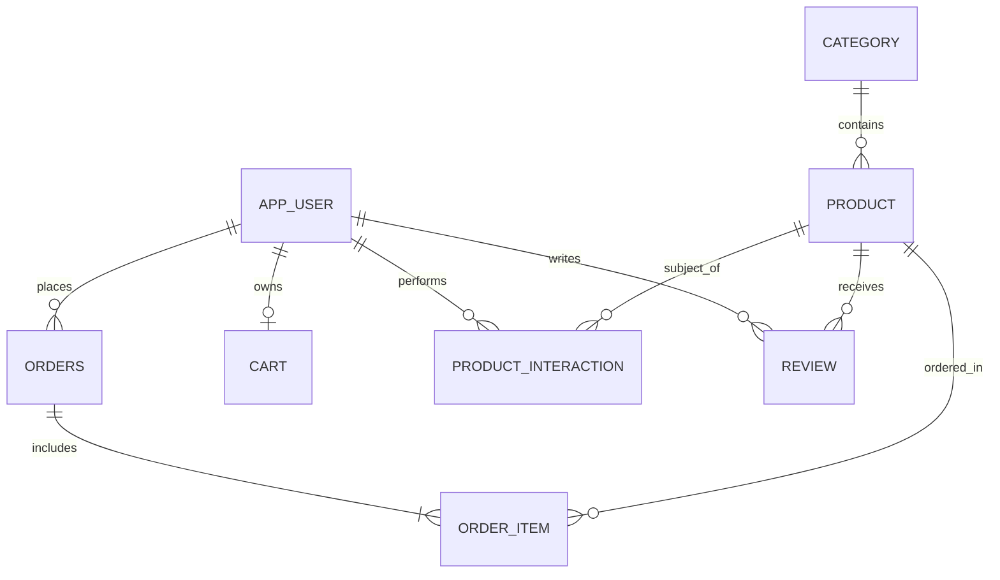

# 🛒 Smart E-Commerce Database Management System (DBMS)

A robust, enterprise-grade relational database design for an intelligent E-Commerce platform built using **Oracle SQL** and **PL/SQL**. This system models core e-commerce workflows including user management, product catalogs, shopping carts, order lifecycles, customer interactions (tracking behavior for recommendations), reviews, and automated business constraints.

---

## 📌 Features & Highlights

- **Normalized Relational Schema (3NF)**: Clean architecture ensuring data integrity, strict referential integrity, and eliminating redundancy.
- **Role-Based Access Control**: Separation between `CUSTOMER` and `ADMIN` roles.
- **Smart Behavioral Tracking**: Captures user interactions (`VIEW`, `CART`, `WISHLIST`, `PURCHASE`) enabling recommendation engines and funnel analysis.
- **Database Automations**: PL/SQL triggers for automated timestamping and negative stock validation.
- **Stored Procedures & Functions**: Reusable modular routines for spending calculations and dynamic product ratings.
- **Optimized Analytical Views & Indexes**: Pre-computed perspectives for order management, customer metrics, and B-Tree indexes on query-heavy foreign keys.

---

## 🏗️ Database Architecture & Schema

The database consists of 8 core tables with strict constraints (`PRIMARY KEY`, `FOREIGN KEY`, `CHECK`, `UNIQUE`):



### Table Breakdown
1. **`App_User`**: User credentials, contact details, role (`CUSTOMER`, `ADMIN`).
2. **`Category`**: Hierarchical classification for products.
3. **`Product`**: Inventory catalog with brand, pricing, and stock quantity checks.
4. **`Cart`**: 1-to-1 active shopping cart per user with automatic timestamp tracking.
5. **`Orders`**: Order metadata, order status lifecycle (`PENDING`, `CONFIRMED`, `SHIPPED`, `DELIVERED`, `CANCELLED`).
6. **`Order_Item`**: Line items for orders preserving historical unit price and quantity.
7. **`Product_Interaction`**: User interaction events for recommendations and behavioral analytics.
8. **`Review`**: Customer ratings (1–5) and feedback with unique customer-product review constraints.

---

## 📂 Project Structure & Script Execution Order

Execute the SQL scripts in numerical order to respect table dependencies and foreign key constraints:

| Script | Title | Description |
|---|---|---|
| [`01_schema.sql`](01_schema.sql) | **Schema Definition** | DDL scripts creating tables, primary/foreign keys, and validation constraints. |
| [`02_sample_data.sql`](02_sample_data.sql) | **Sample Data** | Comprehensive mock datasets across all entities to simulate real-world traffic. |
| [`03_basic_queries.sql`](03_basic_queries.sql) | **Basic Queries** | Essential DQL queries: filtering, sorting, aggregations, and standard joins. |
| [`04_advanced_queries.sql`](04_advanced_queries.sql) | **Advanced Analytics** | Window functions (`DENSE_RANK`, `ROW_NUMBER`), complex subqueries, cohort analysis, and interaction funnels. |
| [`05_views_indexes.sql`](05_views_indexes.sql) | **Views & Indexes** | Performance indexes (B-tree) and analytical views (`Customer_Order_Summary`, `Product_Rating_View`, `Order_Details_View`). |
| [`06_plsql_triggers.sql`](06_plsql_triggers.sql) | **PL/SQL & Triggers** | Stored procedures, functions, and before-insert/update triggers enforcing business logic. |
| [`07_final_test_queries.sql`](07_final_test_queries.sql) | **Verification Suite** | Validation script testing end-to-end workflows, triggers, views, and data integrity. |

---

## 🚀 Getting Started

### Prerequisites
- **Oracle Database** (Oracle 19c, 21c, 23ai, or Oracle Express Edition XE)
- **Database Client**: Oracle SQL Developer, DBeaver, VS Code with Oracle Developer Tools, or `sqlplus` CLI.

### Execution Guide via SQL*Plus or SQL Developer
Connect to your Oracle database schema and execute:

```sql
-- Step 1: Create Schema
@01_schema.sql;

-- Step 2: Seed Sample Data
@02_sample_data.sql;

-- Step 3: Run Baseline Queries
@03_basic_queries.sql;

-- Step 4: Run Analytics & Aggregations
@04_advanced_queries.sql;

-- Step 5: Build Views and Secondary Indexes
@05_views_indexes.sql;

-- Step 6: Deploy PL/SQL Procedures & Triggers
@06_plsql_triggers.sql;

-- Step 7: Run End-to-End Test Suite
@07_final_test_queries.sql;
```

---

## 💡 Key Business Logic & Implementations

### Automated Cart Tracking Trigger
```sql
CREATE OR REPLACE TRIGGER trg_cart_update_date
BEFORE UPDATE ON Cart
FOR EACH ROW
BEGIN
    :NEW.Updated_At := SYSDATE;
END;
/
```

### Dynamic Stock Validation Trigger
```sql
CREATE OR REPLACE TRIGGER trg_check_product_stock
BEFORE INSERT OR UPDATE ON Product
FOR EACH ROW
BEGIN
    IF :NEW.Stock_Quantity < 0 THEN
        RAISE_APPLICATION_ERROR(-20001, 'Stock quantity cannot be negative');
    END IF;
END;
/
```

### Product Average Rating Function
```sql
CREATE OR REPLACE FUNCTION Get_Product_Average_Rating (
    p_product_id IN NUMBER
)
RETURN NUMBER
AS
    v_average_rating NUMBER(3,2);
BEGIN
    SELECT NVL(ROUND(AVG(Rating), 2), 0)
    INTO v_average_rating
    FROM Review
    WHERE Product_ID = p_product_id;

    RETURN v_average_rating;
END;
/
```

---

## 📈 Performance Optimizations

Indexes created for accelerating join paths and high-frequency lookup queries:
- `idx_product_category`: Accelerates catalog filtering by category.
- `idx_orders_user`: Speeds up customer order history retrieval.
- `idx_order_item_order`: Optimizes invoice generation and order detail joins.
- `idx_interaction_user_product`: Indexes user activity logs for fast recommendation matching.

---

## 📄 License
This project is open-source and available under the [MIT License](LICENSE).
